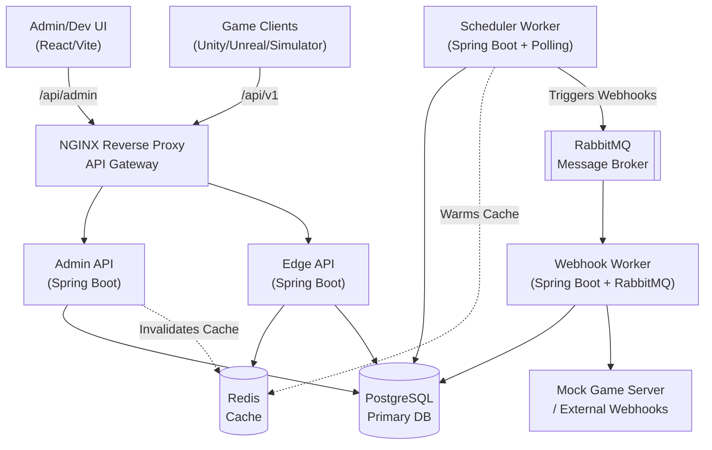

# ChronoFlux: Live Ops Engine

ChronoFlux is a robust, microservice-based Live Operations (LiveOps) engine designed for modern game development. It allows game administrators to define dynamic JSON schemas, schedule live events (e.g., Flash Sales, Raid Boss spawns, Double XP weekends), and securely deliver event payloads to game clients and external webhooks.

## 🚀 Architecture

ChronoFlux employs a modern, distributed microservice architecture to handle high throughput and ensure resilience.

## 🛠️ Technology Stack

| Component | Technology | Purpose |
| --- | --- | --- |
| **Frontend** | React + Vite, Tailwind CSS, TanStack Query | Admin Control Room & Game Client Simulator |
| **Backend Core** | Java 21, Spring Boot 3.4 | Core microservices |
| **Database** | PostgreSQL | Relational data & JSONB for dynamic payloads |
| **Caching** | Redis & Nginx | Proxy caching and cache-aside for Edge API to survive thundering herds |
| **Message Broker** | RabbitMQ | Async webhook delivery with Database-backed retry mechanism |
| **Containerization**| Docker & Docker Compose | Local development and deployment orchestration |
| **Testing** | k6, Testcontainers, JUnit | Load testing and integration testing |
