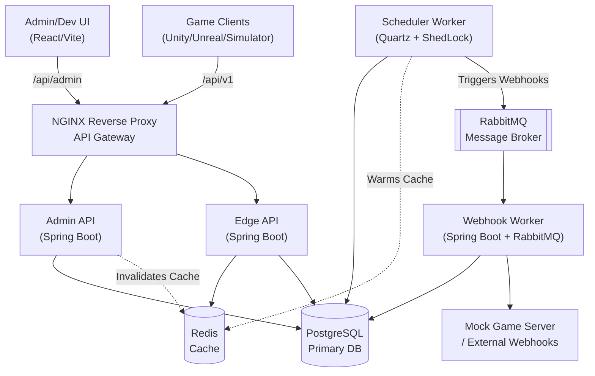

# ChronoFlux: Live Ops Engine

ChronoFlux is a robust, microservice-based Live Operations (LiveOps) engine designed for modern game development. It allows game administrators to define dynamic JSON schemas, schedule live events (e.g., Flash Sales, Raid Boss spawns, Double XP weekends), and securely deliver event payloads to game clients and external webhooks.

## 🚀 Architecture

ChronoFlux employs a modern, distributed microservice architecture to handle high throughput and ensure resilience.



## 🛠️ Technology Stack

| Component | Technology | Purpose |
| --- | --- | --- |
| **Frontend** | React + Vite, Tailwind CSS, TanStack Query | Admin Control Room & Game Client Simulator |
| **Backend Core** | Java 21, Spring Boot 3.4 | Core microservices |
| **Database** | PostgreSQL | Relational data & JSONB for dynamic payloads |
| **Caching** | Redis | Cache-aside for Edge API to survive thundering herds |
| **Distributed Lock** | ShedLock + JDBC | Ensures only 1 Scheduler triggers an event |
| **Message Broker** | RabbitMQ | Async webhook delivery with Dead Letter Queue (DLQ) |
| **Containerization**| Docker & Docker Compose | Local development and deployment orchestration |
| **Testing** | k6, Testcontainers, JUnit | Load testing and integration testing |

## 📡 API Endpoints

### Admin API (Port 8080 internal, `/api/admin/*` via NGINX)
- `GET /schemas` - List all event schemas
- `POST /schemas` - Create a new dynamic JSON schema
- `GET /events` - List all scheduled and active events
- `POST /events` - Schedule an event with a validated JSONB payload
- `POST /webhooks` - Register a webhook for event triggers

### Edge API (Port 8081 internal, `/api/v1/*` via NGINX)
- `GET /events/active` - High-throughput, heavily cached endpoint for game clients to fetch live events.

> 📚 **API Documentation**: Once running, full Swagger UI documentation is available at `http://localhost/api/admin/swagger-ui.html`

## 🏃 How to Run

1. **Clone the repository:**
   ```bash
   git clone https://github.com/swarnendu-sekhar-das/ChronoFlux.git
   cd ChronoFlux
   ```

2. **Boot the stack:**
   The entire system (9 containers including DBs, Broker, and Microservices) is orchestrated via Docker Compose.
   ```bash
   docker compose up -d --build
   ```

3. **Access the Application:**
   - **Admin UI & Simulator**: `http://localhost`
   - **RabbitMQ Management**: `http://localhost:15672` (guest / guest)
   - **Swagger UI**: `http://localhost/api/admin/swagger-ui.html`

## 🎮 Demo Scenarios

### 1. The "Thundering Herd" Proof (Redis Cache-Aside)
When a highly anticipated event starts, millions of clients poll the server simultaneously. ChronoFlux handles this via the Edge API and Redis.
**To verify:**
We use a Dockerized `k6` to simulate 5,000 concurrent Virtual Users (VUs) for 30 seconds.

**Test 1: With Redis Cache ENABLED**
```bash
docker run --rm --network host -i grafana/k6 run - < k6/thundering-herd.js
```
*Results:* **28,684 requests processed (823 req/s) with a p(95) latency of 8.03s.** The application survives the massive traffic spike because 99.9% of requests are served directly from Redis RAM. The database sees exactly one query.

**Test 2: With Redis Cache DISABLED (The Stampede)**
If we disable `@Cacheable` and run the exact same test:
*Results:* **100% Failure Rate.** The database connections are instantly exhausted. Tomcat thread pools fill up. The application completely collapses under the load (avg latency > 30s before dropping).

### 2. Distributed Locking (ShedLock)
The Scheduler worker checks for events every 60 seconds. In a distributed environment with multiple instances, we prevent duplicate event triggers using ShedLock backed by Redis.
**To verify:**
1. Scale the scheduler to 3 instances: `docker-compose up -d --scale scheduler-worker=3`
2. Tail the logs concurrently:
   ```bash
   docker logs chronoflux-scheduler-worker-1 --tail 50 2>&1 | grep "ShedLock"
   docker logs chronoflux-scheduler-worker-2 --tail 50 2>&1 | grep "ShedLock"
   docker logs chronoflux-scheduler-worker-3 --tail 50 2>&1 | grep "ShedLock"
   ```
*Result: Only exactly ONE instance will log `ShedLock acquired! Executing EventActivationJob.`, while the others skip execution because the lock in Redis is held.*

### 3. Webhook Retry & Dead Letter Queue (DLQ)
If a webhook target goes down, ChronoFlux retries with exponential backoff before sending the message to a DLQ.
**To verify:**
1. Stop the mock external server: `docker stop chronoflux-mock-game-server-1`
2. Trigger a manual event activation message:
   ```bash
   docker exec chronoflux-rabbitmq-1 rabbitmqadmin publish exchange=live-ops.events routing_key=event.active payload='{"eventId":"33333333-3333-3333-3333-333333333333", "schemaId":"11111111-1111-1111-1111-111111111111", "payload":"{}"}'
   ```
3. Watch the `webhook-worker` logs retry and eventually fail: `docker logs chronoflux-webhook-worker-1 --tail 50`
4. Verify the message automatically moved to the DLQ:
   ```bash
   docker exec chronoflux-rabbitmq-1 rabbitmqadmin get queue=live-ops.events.webhook-delivery.dlq count=10
   ```
